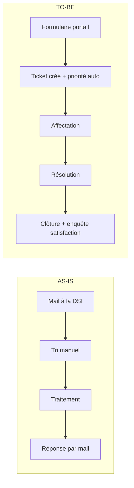

# Business analyse : note de cadrage et user stories

## 1. Problème à résoudre
| Constat (as-is) | Impact |
|---|---|
| Demandes reçues par e-mail, sans numéro de suivi | Demandes perdues, relances multiples |
| Aucune priorisation formelle | Les urgences réelles sont traitées tard |
| Pas d'indicateurs | Impossible de piloter ou de démontrer la charge |

## 2. Objectifs mesurables
- Réduire le délai moyen de résolution de 5 jours à 2 jours
- 100 % des demandes tracées dans l'outil
- Satisfaction utilisateur ≥ 4/5

## 3. Parties prenantes
| Partie prenante | Attente principale |
|---|---|
| Utilisateurs métiers | Faire une demande simplement, suivre son avancement |
| Équipe support (4 pers.) | Une file claire, priorisée |
| DSI | Visibilité et indicateurs |
| Direction | Maîtrise des coûts |

## 4. Processus as-is / to-be

## 5. User stories (extrait du backlog)
| ID | En tant que... | Je veux... | Afin de... | Priorité |
|---|---|---|---|---|
| US-01 | Utilisateur | créer une demande via un formulaire | ne plus écrire de mail | Must |
| US-02 | Utilisateur | suivre l'état de ma demande | éviter de relancer | Must |
| US-03 | Technicien | voir ma file triée par priorité | traiter l'urgent d'abord | Must |
| US-04 | Responsable DSI | consulter un tableau de bord | piloter la charge | Should |
| US-05 | Utilisateur | évaluer le service après clôture | donner mon avis | Could |

### Critères d'acceptation, exemple US-01
- Le formulaire comporte : catégorie, description, urgence, pièce jointe optionnelle
- Un numéro de ticket est généré et envoyé par e-mail
- Le ticket apparaît dans la file du support en moins d'une minute
