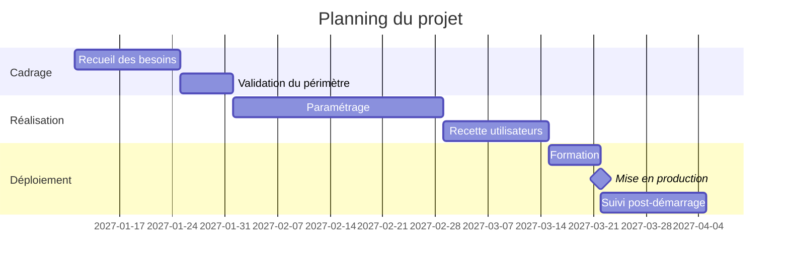

# Gestion de projet : charte, planning, RACI, risques

## 1. Charte projet
| Élément | Contenu |
|---|---|
| Objectif | Mettre en production l'outil de ticketing pour 120 utilisateurs |
| Périmètre inclus | Paramétrage, formulaires, migration des demandes en cours, formation |
| Hors périmètre | Gestion des actifs (CMDB), connexion à la paie |
| Durée | 14 semaines |
| Budget | 25 k€ (licences + paramétrage + formation) |
| Sponsor | Directeur des systèmes d'information |
| Critères de succès | Mise en production à la date prévue, objectifs de la note de cadrage atteints |

## 2. Planning

## 3. Matrice RACI
R = Réalise · A = Approuve · C = Consulté · I = Informé

| Activité | Chef de projet | BA | Support IT | DSI | Utilisateurs clés |
|---|---|---|---|---|---|
| Recueil des besoins | A | R | C | I | C |
| Paramétrage | A | C | R | I | I |
| Recette | A | R | C | I | R |
| Formation | R | C | C | I | I |
| Mise en production | R | I | C | A | I |

## 4. Registre des risques
| # | Risque | Probabilité | Impact | Réponse | Responsable |
|---|---|---|---|---|---|
| R1 | Faible adoption par les utilisateurs | Moyenne | Élevé | Utilisateurs clés ambassadeurs, formation courte, communication | Chef de projet |
| R2 | Support peu disponible pour la recette | Moyenne | Moyen | Planifier les créneaux dès le cadrage | Chef de projet |
| R3 | Dérive du périmètre | Élevée | Moyen | Comité de validation des changements | DSI |
| R4 | Migration des données incomplète | Faible | Élevé | Reprise à blanc avant la mise en production | Support IT |

## 5. Plan de communication
| Cible | Message | Fréquence | Canal |
|---|---|---|---|
| Comité de pilotage | Avancement, risques, décisions | Toutes les 2 semaines | Réunion + compte rendu |
| Équipe projet | Points d'avancement | Hebdomadaire | Réunion de 30 min |
| Utilisateurs | Dates clés, nouveautés | Mensuelle puis à J-15 | E-mail |
