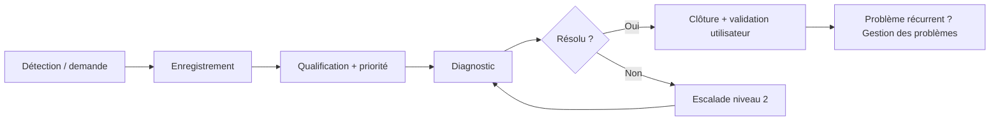

# Pilotage du service : engagements, KPI et amélioration continue

## 1. Priorités et engagements de service (SLA)
| Priorité | Définition | Prise en charge | Résolution |
|---|---|---|---|
| P1 | Service critique à l'arrêt | 30 min | 4 h |
| P2 | Fonction majeure dégradée | 2 h | 1 jour ouvré |
| P3 | Gêne limitée, contournement possible | 1 jour ouvré | 3 jours ouvrés |
| P4 | Demande standard | 2 jours ouvrés | 5 jours ouvrés |

Horaires du support : 8 h - 18 h, jours ouvrés.

## 2. Processus de gestion des incidents (inspiré ITIL)

## 3. Indicateurs de service (KPI)
| KPI | Formule | Cible |
|---|---|---|
| Respect du SLA | tickets résolus dans le délai / total | ≥ 90 % |
| Délai moyen de résolution | somme des délais / nombre de tickets | ≤ 2 jours |
| Résolution au premier contact | tickets résolus niveau 1 / total | ≥ 60 % |
| Taux de réouverture | tickets rouverts / tickets clôturés | ≤ 5 % |
| Satisfaction utilisateur | moyenne des notes | ≥ 4 / 5 |

## 4. Exemple de rapport mensuel (données fictives)
| KPI | Cible | Mois M-1 | Mois M | Tendance |
|---|---|---|---|---|
| Respect du SLA | 90 % | 84 % | 91 % | ↗ |
| Délai moyen (jours) | 2,0 | 2,6 | 2,1 | ↗ |
| Premier contact | 60 % | 52 % | 58 % | ↗ |
| Satisfaction | 4,0 | 3,8 | 4,1 | ↗ |

**Analyse** : amélioration liée aux réponses types pour les demandes P4.
**Point de vigilance** : la résolution au premier contact reste sous la cible.

## 5. Plan d'amélioration continue (PDCA)
| Étape | Action |
|---|---|
| Plan | Analyser les 10 catégories de tickets les plus fréquentes (Pareto) |
| Do | Créer des articles de base de connaissances pour les 3 premières |
| Check | Mesurer la résolution au premier contact sur 2 mois |
| Act | Généraliser à d'autres catégories ou ajuster |
